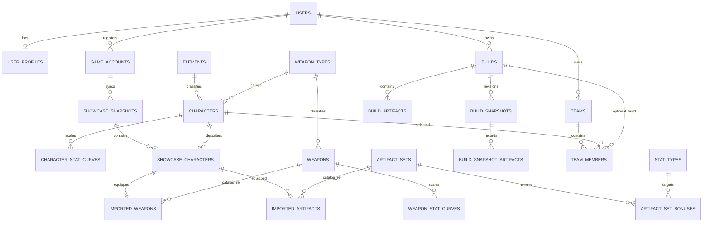

# Database design and ERD

Use numeric internal primary keys plus stable provider/game identifiers (`game_id`, `avatar_id`) with unique constraints. Decimal columns preserve stat precision. Catalog rows are shared; all user records carry ownership through an account/user foreign key or an owned parent. Keep imported snapshot rows immutable. Store raw provider JSON only as an optional, retention-limited diagnostic blob, not as the application's data model.

## Tables

### Users and accounts

- `users`: Laravel auth identity, email unique, password hash, timestamps.
- `user_profiles`: `user_id` unique FK, display preferences/settings; avoid duplicating auth fields.
- `game_accounts`: `user_id`, `uid` (string to preserve formatting), `region`, optional label, `last_synced_at`; unique (`user_id`,`uid`,`region`). UID is not proof of ownership.

### Shared catalog

- `elements`, `weapon_types`, `artifact_slots`, `stat_types`: small lookup tables with stable keys.
- `characters`: unique game/avatar ID, localized-name key, element/type FKs, rarity, icon key, catalog version.
- `character_stat_curves`: character FK, level, ascension phase, base HP/ATK/DEF and ascension stat type/value. Unique character + progression point.
- `weapons`: unique game ID, name key, weapon type, rarity, icon key, secondary stat type.
- `weapon_stat_curves`: weapon FK, level, ascension phase, base ATK and secondary value.
- `artifact_sets`: stable set ID/name key/version.
- `artifact_set_bonuses`: set FK, piece count, effect kind, target stat/value or a versioned effect key. Keep authored effect definitions structured; do not put all bonuses in opaque JSON.
- `catalog_releases`: source, source version/commit, imported timestamp, supported game version, attribution/license notes.

### Imported showcase data

- `showcase_snapshots`: `game_account_id`, provider, fetched time, source TTL, content hash, optional raw payload, status. Unique account + content hash can suppress duplicate snapshots.
- `showcase_snapshot_characters`: snapshot FK, character FK, level, ascension, constellation, friendship nullable, talent values, normalized combat stats; unique snapshot + character. Rarely varying talent shape can use explicit normal/skill/burst columns; unsupported talents remain null.
- `imported_weapons`: snapshot-character FK unique, weapon catalog FK nullable, level, ascension, refinement, original external ID.
- `imported_artifacts`: snapshot-character FK, slot, catalog set FK nullable, external item ID nullable, rarity, level, main stat, normalized substat rows; unique showcase character + slot.
- `imported_artifact_substats`: imported artifact FK, ordinal, stat FK, decimal value.

Each confirmed sync creates an immutable snapshot and advances the account's latest-snapshot pointer (or queries latest by timestamp). This preserves evidence for history without overwriting user builds.

### User builds and history

- `builds`: user FK, character FK, optional source showcase-character FK for provenance only, name, character level/ascension/constellation/talents, optional weapon catalog FK and entered weapon progression, notes, timestamps, soft delete. Unique constraints need not forbid same-name builds; index user + character.
- `build_artifacts`: build FK, slot, optional set FK, rarity/level, main stat type/value, entered substats. Unique build + slot.
- `build_artifact_substats`: artifact FK, ordinal, stat FK, decimal value.
- `build_snapshots`: build FK, reason, captured time, content hash, immutable stat result/version, and copied scalar build state. Unique build + hash prevents unchanged duplicates.
- `build_snapshot_artifacts` and `build_snapshot_artifact_substats`: immutable copies for artifact-level change inspection.

Notes can be a `notes` column on builds initially. Add `build_notes` only if notes become separate multi-entry/comment records; avoid redundant one-to-one table.

### Teams

- `teams`: user FK, name, notes, timestamps.
- `team_members`: team FK, character FK, optional build FK, role enum/check, position 0–3. Unique team + position and team + character; enforce max four and build-character match in service logic/transaction.

### Temporary optimizer inputs

Do not persist candidate artifacts as inventory. Optimizer submissions are validated transient payloads in cache/worker memory. If resumable jobs become necessary, add expiring `optimizer_jobs` and `optimizer_candidates` with owner, expiry, and cleanup policy; selected output is copied into `builds` only after explicit save.

## Integrity and indexing

Foreign keys use restrictive deletes for catalog data, cascading deletes for owned children where appropriate, and soft deletes only for user-facing builds/accounts where recovery matters. Add indexes on owner + update time, account + snapshot time, snapshot + character, build + character, and catalog foreign keys. Use transactions for account, snapshot, character, equipment, and artifact writes. Do not cascade-delete immutable historical evidence when a current build changes.

